<div align="center">

# 🔥 effis-client

**Europe's official wildfire data, in three lines of async Python.**

Burnt-area perimeters and the official Fire Weather Index from
[EFFIS](https://forest-fire.emergency.copernicus.eu/), the European Forest Fire
Information System of the Copernicus Emergency Management Service.
No account. No API key. No silent failures.

[](https://github.com/agent-engineering-studio/effis-client/actions/workflows/ci.yml)
[](https://pypi.org/project/effis-client/)
[](https://pypi.org/project/effis-client/)
[](./LICENSE)
[](https://creativecommons.org/licenses/by/4.0/)
[](./pyproject.toml)
[](./tests)

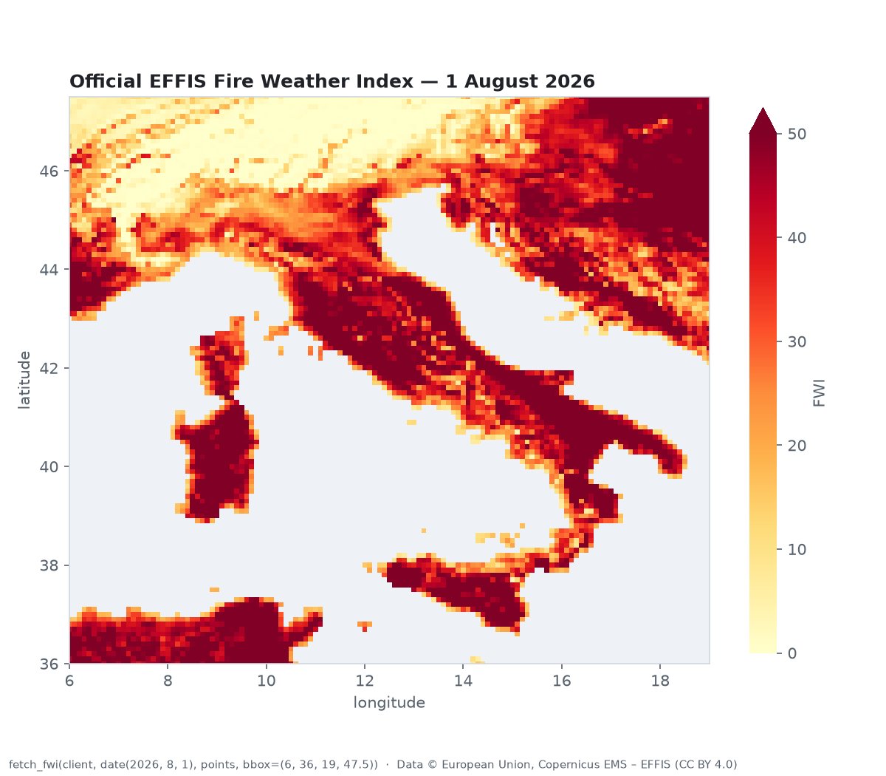

<sub>The official EFFIS Fire Weather Index over Italy on 1 August 2026, fetched with this library.</sub>

</div>

---

## Contents

- [Why this exists](#why-this-exists)
- [What you get](#what-you-get)
- [Install](#install)
- [Quick start](#quick-start)
- [How it works](#how-it-works)
- [The MapServer traps it handles](#the-mapserver-traps-it-handles)
- [Burnt-area perimeters](#burnt-area-perimeters)
- [The Fire Weather Index chain](#the-fire-weather-index-chain)
- [Cookbook](#cookbook)
- [API reference](#api-reference)
- [Error model](#error-model)
- [Who is it for](#who-is-it-for)
- [Roadmap and ideas](#roadmap-and-ideas)
- [Contributing](#contributing)
- [Support the project](#support-the-project)
- [Data licence and attribution](#data-licence-and-attribution)
- [License](#license)

---

## Why this exists

Wildfires in Europe are getting larger, earlier and further north. The data to
study them is public and excellent: EFFIS maps burnt areas from satellite
imagery every fire season, and publishes the daily Fire Weather Index for the
whole continent. Researchers, civil-protection teams, journalists, insurers and
students all need it.

Getting it out programmatically, though, is a trap. The endpoints are
**MapServer**, not GeoServer, and every habit you bring from GeoServer fails
differently, usually **without an error**. You can get every fire ever recorded
when you asked for one summer. You can get a raster that says "no fire danger
anywhere" when it really means "no data". The HTTP status is 200 either way.

`effis-client` is the small, boring, well-tested layer that knows these traps,
so your analysis does not inherit them.

> **Two HTTP calls, nine ways to get them silently wrong.** This library exists
> so you never have to discover them yourself.

## What you get

| | |
|---|---|
| 🗺️ **Burnt-area perimeters** | GeoJSON polygons from the EFFIS WFS (`nrt.ba.poly`), filtered to your bounding box and date range |
| 🌡️ **Official Fire Weather Index** | The complete Canadian FWI System (FWI, FFMC, DMC, DC, ISI, BUI) as **raw float values**, sampled at any point |
| 🛡️ **No silent failures** | XML errors disguised as HTTP 200 raise `EffisError`; an all-zero "no data" raster returns `None`, never `0.0` |
| ⚡ **Async-first** | Built on `httpx.AsyncClient`, which **you** inject: your timeouts, retries, proxies and connection pool |
| 🧩 **Bring your own HTTP** | Every step is also a pure function: build parameters, send them with any client, parse the response |
| 🪶 **Tiny footprint** | One required dependency (`httpx`); `numpy` + `rasterio` only if you sample FWI rasters |
| ✅ **Production quality** | `mypy --strict`, 100 % test coverage, `py.typed`, trusted publishing to PyPI |
| 🔓 **Free and open** | Apache-2.0 code, CC BY 4.0 data, no credentials anywhere |

## Install

```bash
pip install effis-client           # burnt-area perimeters
pip install "effis-client[raster]" # + Fire Weather Index sampling (numpy, rasterio)
```

With [uv](https://docs.astral.sh/uv/):

```bash
uv add effis-client
uv add "effis-client[raster]"
```

Requires Python 3.12 or newer.

## Quick start

```python
import asyncio
from datetime import date

import httpx

from effis_client import fetch_fwi, fetch_perimeters


async def main() -> None:
    async with httpx.AsyncClient(timeout=60) as client:
        # Bounding boxes are (west, south, east, north) in EPSG:4326.
        perimeters = await fetch_perimeters(
            client,
            (16.5, 40.3, 16.8, 40.6),
            start=date(2021, 1, 1),
            end=date(2026, 12, 31),
        )
        print(len(perimeters.features), "fires since 2021")

        fwi = await fetch_fwi(
            client,
            date(2026, 11, 1),
            points=[(16.6, 40.6)],  # (lon, lat)
            bbox=(15.0, 39.5, 17.5, 41.5),
        )
        print(fwi)  # {(16.6, 40.6): 10.34...}, or None if EFFIS has no data


asyncio.run(main())
```

That is the whole API surface for most users: **two functions**.

---

## How it works

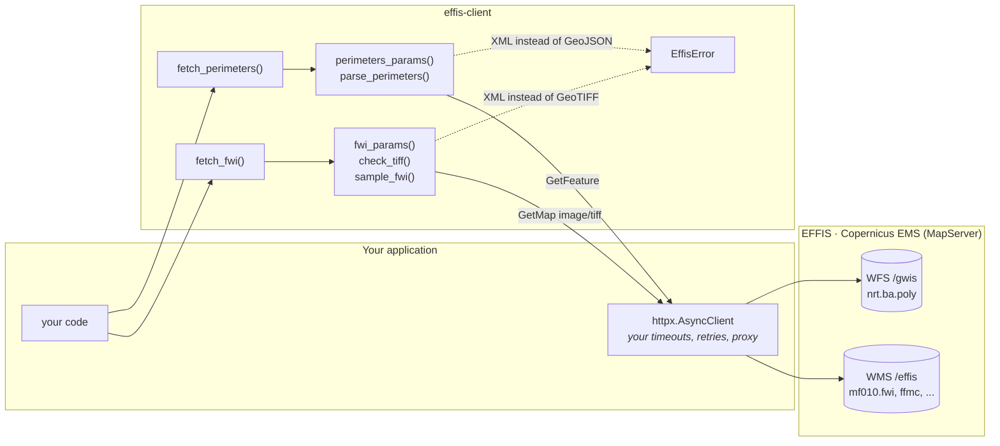

The library is split into two layers on purpose:

1. **Pure functions** that build request parameters and parse responses. No I/O,
   trivially testable, usable with `requests`, `aiohttp`, a cache, a queue
   worker, anything.
2. **Thin `fetch_*` coroutines** that glue the pure functions to the
   `httpx.AsyncClient` you pass in. The client is never created or closed by
   the library, so connection pooling, retries and timeouts stay under your
   control.

### A perimeters request, step by step

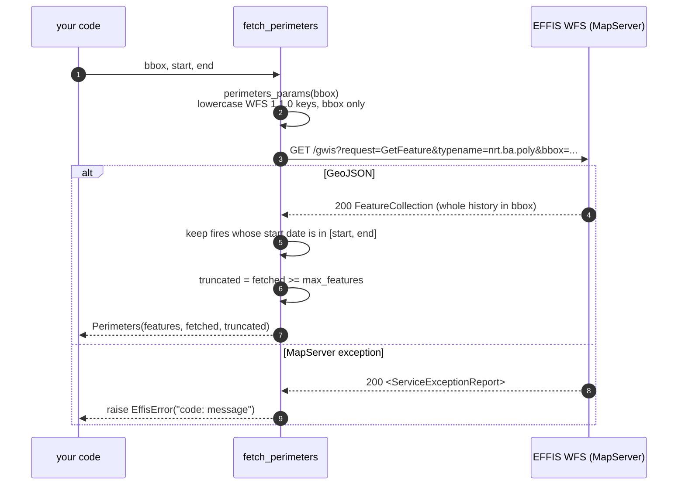

### An FWI request, step by step

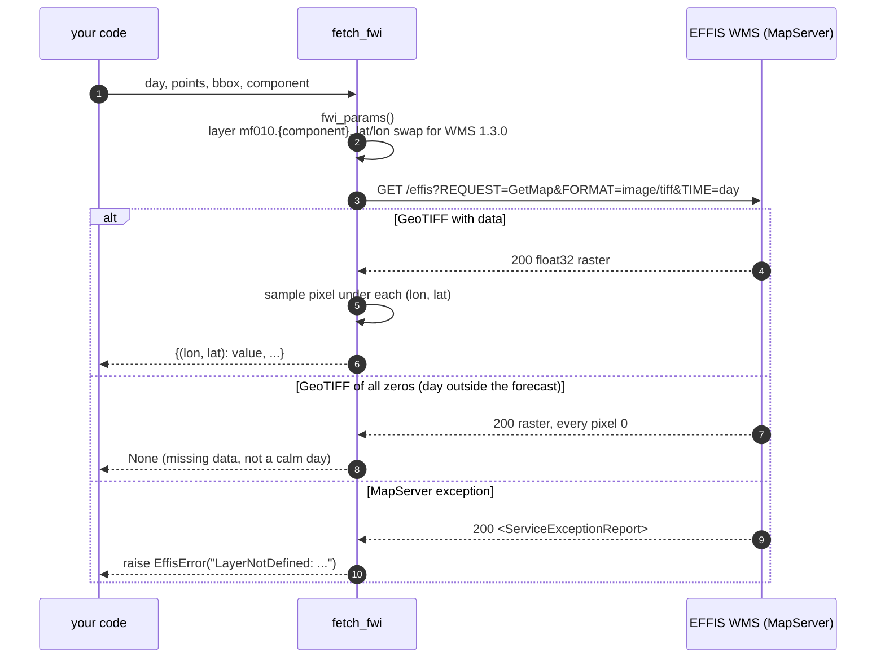

---

## The MapServer traps it handles

Every row was found the hard way and checked again against the live service on
2 November 2026.

| You try | What actually happens | What `effis-client` does |
|---|---|---|
| `/gwis/ows` (the GeoServer habit) | the request **hangs** | uses `/gwis` |
| a wrong `typeName` | the connection **closes mid-response**, no 404 | uses the verified `nrt.ba.poly` |
| `CQL_FILTER` for dates | **silently ignored**: you get every fire ever | filters dates locally, after the bbox query |
| `bbox` + `filter` together | the connection **dies** | sends only the bbox |
| camelCase WFS parameters | **refused** by MapServer's WFS 1.1.0 | sends lowercase keys |
| `ecmwf007.fwi` (the layer in the EFFIS docs) | `LayerNotDefined` | uses `mf010.<component>` |
| WMS 1.3.0 with lon/lat bbox order | the wrong region, quietly | swaps to lat/lon for you |
| any error | HTTP **200** with an XML body | raises `EffisError` with the code and message |
| FWI for a day past the forecast | HTTP 200 with a raster of **zeros** | returns `None` |

The last one is the dangerous one:

<p align="center">
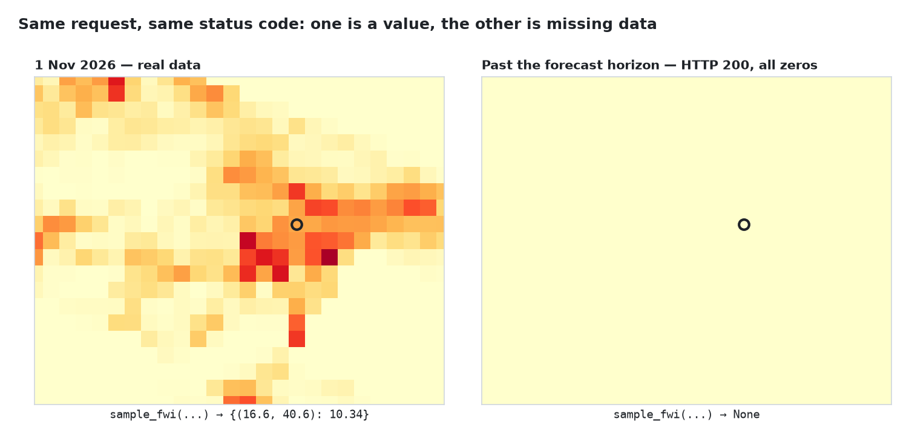
</p>

An all-zero FWI raster reads as "no fire danger anywhere". It means "no data".
A dashboard or a model that takes it at face value will report calm weather on
the day it has no information at all. `effis-client` returns `None` for it, so
the absence of data stays visible.

---

## Burnt-area perimeters

The EFFIS **Rapid Damage Assessment** maps burnt areas from satellite imagery
(MODIS, VIIRS, Sentinel-2) during the fire season. Each feature is a GeoJSON
polygon with properties like:

```json
{
  "id": "384188",
  "fire_id": "384188",
  "initialdate": "2012-06-18 01:00:00",
  "finaldate": "2012-06-18 01:00:00",
  "area": "160"
}
```

`area` is in hectares. The start date is read from whichever of
`initialdate`, `firedate`, `FIREDATE` or `fire_date` the layer carries
(`feature_date()` does this for you).

<p align="center">
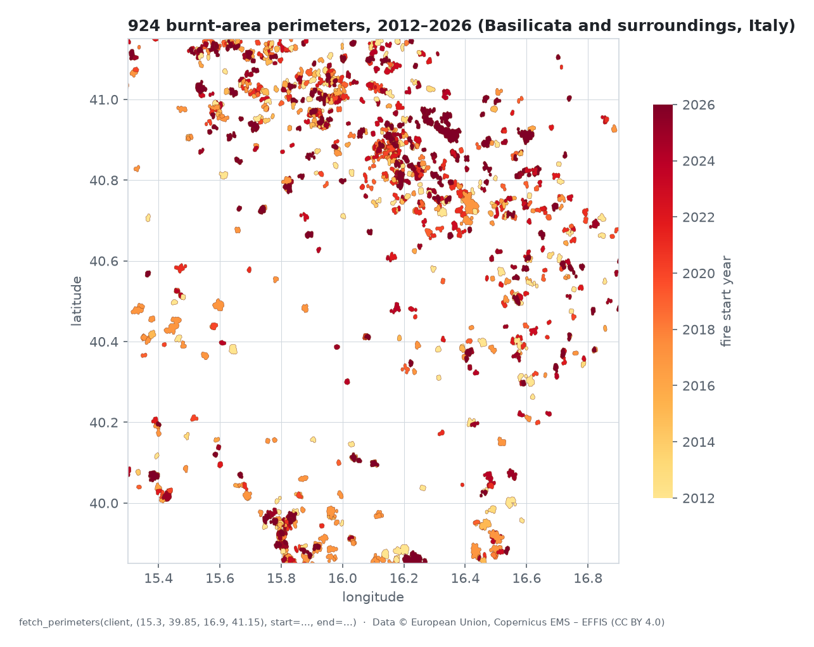
</p>

<p align="center">
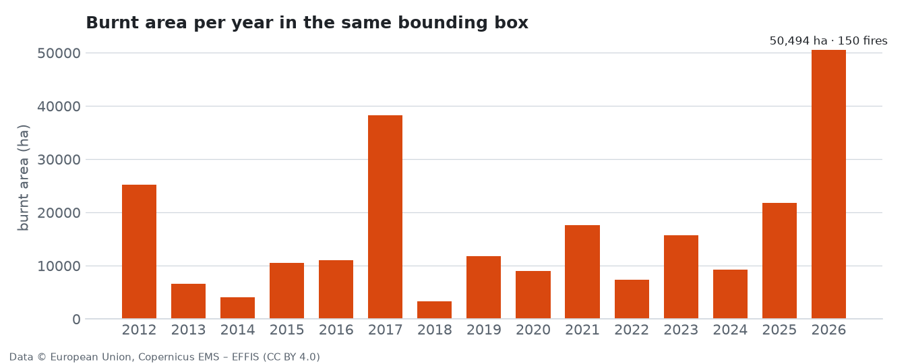
</p>

<sub>Both figures come from a single `fetch_perimeters` call: one bounding box
returned 924 perimeters spanning 2012 to 2026.</sub>

### Why dates are filtered locally

MapServer cannot filter by date on the server: `CQL_FILTER` is ignored and an
OGC `filter` cannot be combined with `bbox`. So the library asks for the whole
history inside the bbox and filters locally. In practice this is cheap: an
Italian region is a few hundred perimeters and a few hundred kilobytes.

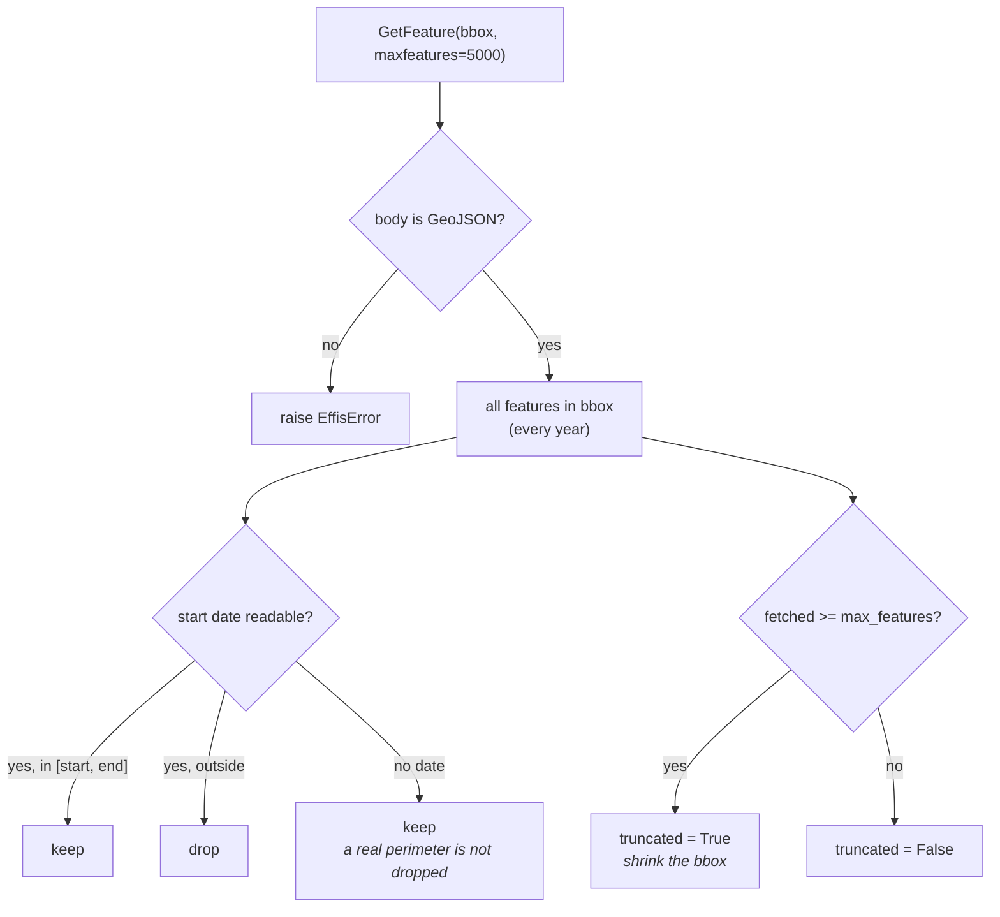

> **`truncated` matters.** If the response hits `max_features` (5000 by
> default), the local date filter worked on a partial set and a missing season
> could look like "no fires". When `perimeters.truncated` is `True`, shrink the
> bbox rather than trusting the gap.

---

## The Fire Weather Index chain

The **Canadian Forest Fire Weather Index System** is the European standard for
fire danger. EFFIS computes it daily on Météo-France weather data and serves
each component as a raster. This library asks for those rasters as **float32
GeoTIFFs** (raw values, not coloured map tiles) and samples them at your points.

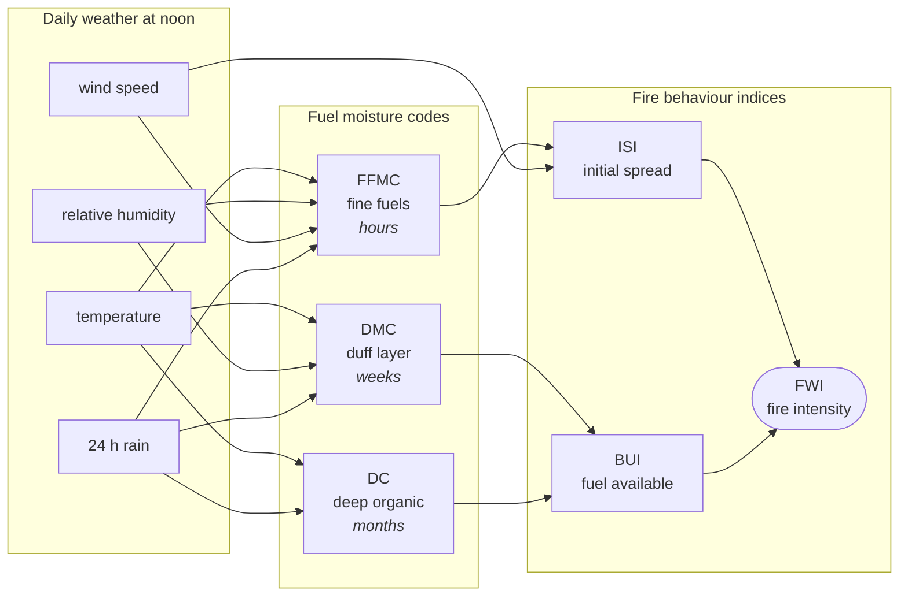

| Component | `component=` | What it tracks |
|---|---|---|
| Fine Fuel Moisture Code | `"ffmc"` | moisture of litter and fine fuels; how easily a fire ignites |
| Duff Moisture Code | `"dmc"` | moisture of loosely compacted organic layers |
| Drought Code | `"dc"` | deep, slow-drying organic layers; seasonal drought |
| Initial Spread Index | `"isi"` | expected rate of spread |
| Buildup Index | `"bui"` | total fuel available for combustion |
| **Fire Weather Index** | `"fwi"` (default) | overall fire intensity; the headline number |

<p align="center">
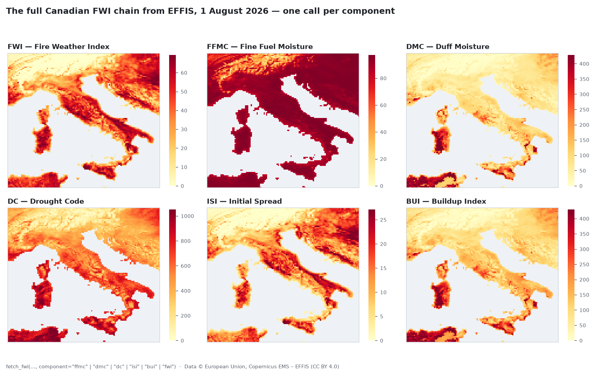
</p>

EFFIS classifies FWI into danger classes; for reference:

| FWI | < 5.2 | 5.2 – 11.2 | 11.2 – 21.3 | 21.3 – 38.0 | 38.0 – 50.0 | ≥ 50.0 |
|---|---|---|---|---|---|---|
| Danger | very low | low | moderate | high | very high | extreme |

### What the WMS accepts

- **Days:** any past day, today and the next two. Beyond that you get the
  all-zero raster, which `fetch_fwi` turns into `None`.
- **Resolution:** you choose the pixel size with `step` (degrees, default
  `0.05`). The bbox and step set the raster's width and height.
- **Sea and points outside the bbox:** sea pixels are zero on valid days too;
  a point on land reads its own pixel. Points outside the raster, or on a
  non-finite pixel, are left out of the result dict.

---

## Cookbook

### Load perimeters into GeoPandas

```python
import geopandas as gpd

perimeters = await fetch_perimeters(client, bbox, start=start, end=end)
gdf = gpd.GeoDataFrame.from_features(perimeters.features, crs="EPSG:4326")
gdf["area"] = gdf["area"].astype(float)  # hectares
print(gdf.sort_values("area", ascending=False).head())
```

### Save perimeters to a GeoJSON file for QGIS

```python
import json
from pathlib import Path

collection = {"type": "FeatureCollection", "features": perimeters.features}
Path("fires.geojson").write_text(json.dumps(collection))
```

### Every FWI component for a list of weather stations, concurrently

```python
from effis_client import COMPONENTS, fetch_fwi

stations = {"Potenza": (15.80, 40.64), "Matera": (16.60, 40.67), "Policoro": (16.68, 40.21)}
bbox = (15.0, 39.5, 17.5, 41.5)
day = date(2026, 8, 1)

results = await asyncio.gather(
    *(fetch_fwi(client, day, list(stations.values()), bbox, component=c) for c in COMPONENTS)
)
for component, values in zip(COMPONENTS, results):
    if values is None:
        print(component, "no data")
        continue
    for name, point in stations.items():
        print(f"{component:>4} {name:<9} {values.get(point)}")
```

### A daily FWI time series for one season

```python
from datetime import date, timedelta

point = (16.60, 40.67)
days = [date(2026, 6, 1) + timedelta(d) for d in range(92)]

async def one(day: date) -> tuple[date, float | None]:
    values = await fetch_fwi(client, day, [point], bbox=(16.0, 40.0, 17.0, 41.0))
    return day, None if values is None else values.get(point)

series = await asyncio.gather(*(one(d) for d in days))
```

Be kind to a free public service: cap concurrency (an `asyncio.Semaphore` or
`httpx.Limits(max_connections=4)`) for long runs.

### Retries, timeouts and a proxy, all yours

```python
transport = httpx.AsyncHTTPTransport(retries=3)  # retries connection failures
async with httpx.AsyncClient(
    transport=transport,
    timeout=httpx.Timeout(60, connect=10),
    limits=httpx.Limits(max_connections=4),
    proxy="http://proxy.internal:3128",
) as client:
    perimeters = await fetch_perimeters(client, bbox, start=start, end=end)
```

### Bring your own HTTP (sync, `requests`, a cache...)

Every step the `fetch_*` functions perform is public and pure:

```python
import requests

from effis_client import (
    WFS_URL, perimeters_params, parse_perimeters,
    WMS_URL, fwi_params, check_tiff, sample_fwi,
)

r = requests.get(WFS_URL, params=perimeters_params(bbox), timeout=60)
r.raise_for_status()
perimeters = parse_perimeters(r.content, start=start, end=end)

r = requests.get(WMS_URL, params=fwi_params(day, bbox, component="isi"), timeout=60)
r.raise_for_status()
isi = sample_fwi(check_tiff(r.headers["content-type"], r.content), points)
```

This is also the easy way to cache responses on disk, run inside a worker
queue, or test your own code against recorded fixtures.

### Join perimeters and FWI: what was the danger on the day each fire started?

```python
from effis_client import feature_date

for feature in perimeters.features[:20]:
    day = feature_date(feature)
    if day is None:
        continue
    lon, lat = feature["geometry"]["coordinates"][0][0]  # first vertex is enough here
    bbox = (lon - 0.5, lat - 0.5, lon + 0.5, lat + 0.5)
    values = await fetch_fwi(client, day, [(lon, lat)], bbox)
    print(day, feature["properties"]["area"], "ha", "FWI:", values and values.get((lon, lat)))
```

This is the kind of question `effis-client` was built for: it comes from
[Limen](https://github.com/agent-engineering-studio/limen), which uses the
perimeters as the truth set for its wildfire backtest.

---

## API reference

All names are importable from the package root.

### Perimeters

| Name | Kind | Description |
|---|---|---|
| `fetch_perimeters(client, bbox, *, start, end, url=WFS_URL, layer=LAYER, max_features=5000)` | `async` | Burnt-area perimeters intersecting `bbox` whose fire started in `[start, end]` |
| `Perimeters` | frozen dataclass | `features: list[dict]`, `fetched: int` (before the date filter), `truncated: bool` |
| `perimeters_params(bbox, *, layer, max_features)` | pure | Query parameters of the WFS `GetFeature` request |
| `parse_perimeters(content, *, start, end, max_features)` | pure | Parse a response body; raises `EffisError` on non-GeoJSON |
| `feature_date(feature)` | pure | The fire's start `date`, or `None` |
| `WFS_URL`, `LAYER`, `DEFAULT_MAX_FEATURES` | constants | `…/gwis`, `"nrt.ba.poly"`, `5000` |

### Fire Weather Index

| Name | Kind | Description |
|---|---|---|
| `fetch_fwi(client, day, points, bbox, *, component="fwi", step=0.05, url=WMS_URL)` | `async` | `{(lon, lat): value}`, or `None` if EFFIS has no data for `day` |
| `fwi_params(day, bbox, *, component, step)` | pure | Query parameters of the WMS `GetMap` request |
| `check_tiff(content_type, body)` | pure | Return the body if it is a GeoTIFF, else raise `EffisError` |
| `sample_fwi(tiff, points)` | pure | Sample the raster under each point; `None` if all zeros (needs `[raster]`) |
| `COMPONENTS`, `Component` | constants / type | `("fwi", "ffmc", "dmc", "dc", "isi", "bui")` and its `Literal` |
| `WMS_URL` | constant | `…/effis` |

### Conventions

- **Bounding boxes** are `(west, south, east, north)` in EPSG:4326 degrees.
- **Points** are `(lon, lat)`.
- **Dates** are `datetime.date`; ranges are inclusive.

---

## Error model

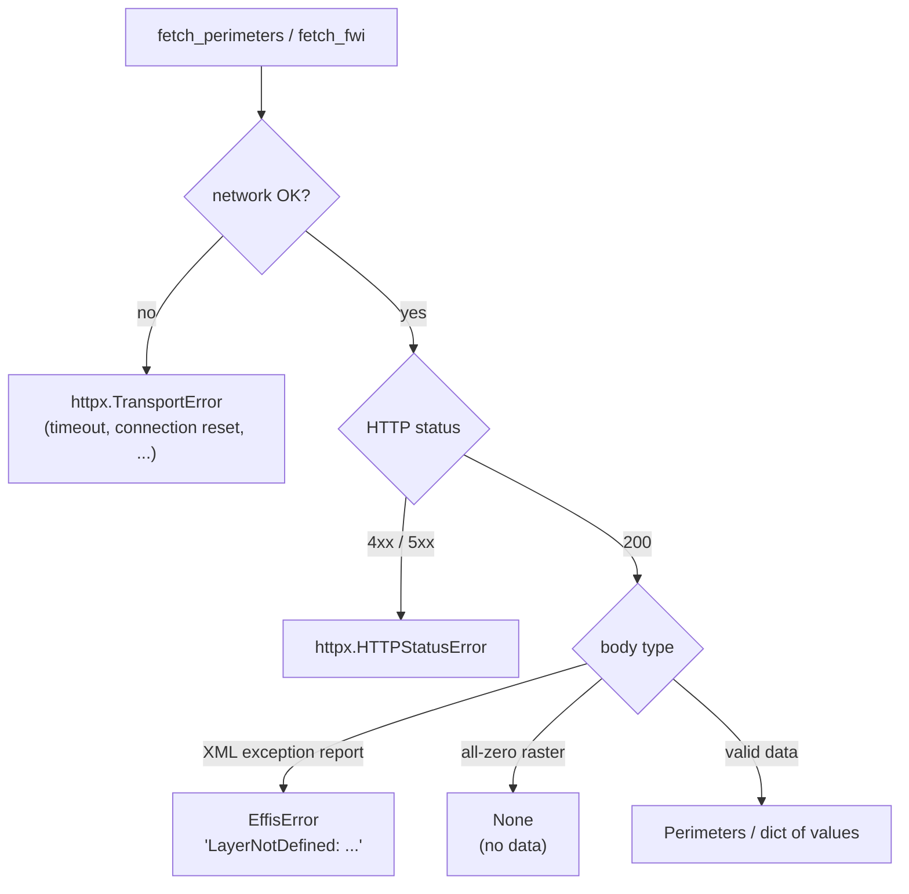

Nothing is swallowed. Network and HTTP errors propagate as `httpx` exceptions;
an error dressed up as a 200 becomes an `EffisError` carrying MapServer's own
code and message; "no data" is `None`. An empty result is only ever an empty
result.

```python
from effis_client import EffisError

try:
    fwi = await fetch_fwi(client, day, points, bbox)
except EffisError as exc:
    log.error("EFFIS refused the request: %s", exc)
except httpx.HTTPError as exc:
    log.warning("EFFIS unreachable, will retry: %s", exc)
else:
    if fwi is None:
        log.info("no FWI published for %s yet", day)
```

---

## Who is it for

- 🔬 **Researchers and data scientists** building fire-risk models,
  validating forecasts or studying burnt-area trends.
- 🚒 **Civil protection and forestry agencies** wiring official EFFIS data into
  dashboards and alerting pipelines.
- 🛰️ **Earth-observation and GIS developers** who need clean polygons and
  numeric rasters, not map tiles.
- 📰 **Data journalists** covering wildfire seasons with reproducible numbers.
- 🏦 **Insurance and climate-risk analysts** quantifying exposure.
- 🎓 **Students and educators** who want real European fire data in a notebook
  in minutes.

If you use `effis-client`, please
[open an issue](https://github.com/agent-engineering-studio/effis-client/issues)
and tell us what you built. A list of users helps the project and helps other
people find it.

## Roadmap and ideas

These are directions, not promises. Each one is a good first contribution, and
an issue to discuss it is welcome before a pull request.

- [ ] A synchronous wrapper for scripts and notebooks
- [ ] Other EFFIS layers: active-fire hotspots, fire danger forecasts
- [ ] Optional GeoPandas / xarray helpers behind extras
- [ ] A small CLI: `effis perimeters --bbox ... --since 2021 > fires.geojson`
- [ ] Recorded-response test helpers for downstream projects
- [ ] A gallery of example notebooks

Have another idea? [Open an issue](https://github.com/agent-engineering-studio/effis-client/issues/new).

## Contributing

Issues and pull requests are welcome, from typo fixes to new layers.

```bash
git clone https://github.com/agent-engineering-studio/effis-client
cd effis-client
uv sync
make check   # ruff, mypy --strict and pytest: the same gate CI runs
```

- Tests run against **recorded EFFIS responses** in `tests/fixtures/`, so they
  are fast and do not hit the network.
- Commits follow [Conventional Commits](https://www.conventionalcommits.org/).
- Found a new MapServer quirk? That is a valuable contribution on its own:
  open an issue with the request and the response you got.

See [CONTRIBUTING.md](./CONTRIBUTING.md) for details and the
[CHANGELOG](./CHANGELOG.md) for what changed.

### Regenerating the figures

The images in this README come from live EFFIS data and the test fixtures:

```bash
uv run python docs/scripts/fetch_data.py /tmp/effis-data
uv run --with matplotlib python docs/scripts/render_images.py /tmp/effis-data docs/images tests/fixtures
```

## Support the project

`effis-client` is free and maintained in spare time. The most useful things you
can do:

- ⭐ **Star the repository.** It is the simplest signal that this work matters,
  and it helps others find it.
- 📣 **Share it** with a colleague, a research group or a civil-protection team
  who works with wildfire data.
- 🐛 **Report** quirks, broken layers and confusing docs.
- 🧑‍💻 **Contribute** code, examples or notebooks from the roadmap.
- 📝 **Cite it** in papers and reports that use it, alongside the EFFIS data
  citation.
- 🤝 **Get in touch** if your organisation depends on EFFIS data and wants to
  support or sponsor further development.

## Data licence and attribution

EFFIS data are © European Union, Copernicus Emergency Management Service,
published under [CC BY 4.0](https://creativecommons.org/licenses/by/4.0/).
Anything you publish from them must say so, for example:

> Data: European Forest Fire Information System (EFFIS), Copernicus Emergency
> Management Service, © European Union, CC BY 4.0.

The test fixtures and the figures in this README are EFFIS data under the same
licence.

`effis-client` is an independent open-source project. It is not affiliated
with or endorsed by the European Commission, the Joint Research Centre or the
Copernicus programme.

Extracted from [Limen](https://github.com/agent-engineering-studio/limen),
which uses the perimeters as the truth set for its wildfire backtest and the
FWI rasters to check its own FWI chain
([`fwi-chain`](https://github.com/agent-engineering-studio/fwi-chain)).

## License

Code: [Apache-2.0](./LICENSE). Contributions are accepted under the same
license.

<div align="center">
<sub>Made for the people who keep Europe's forests from burning. 🌲</sub>
</div>
